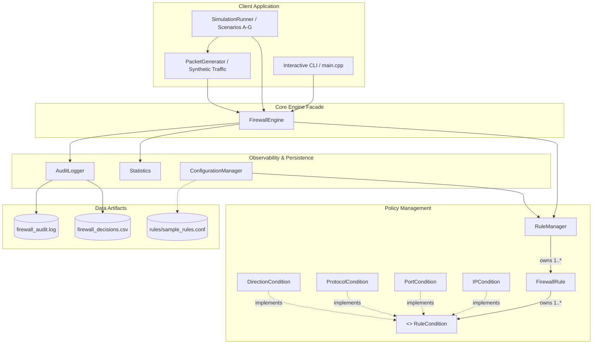
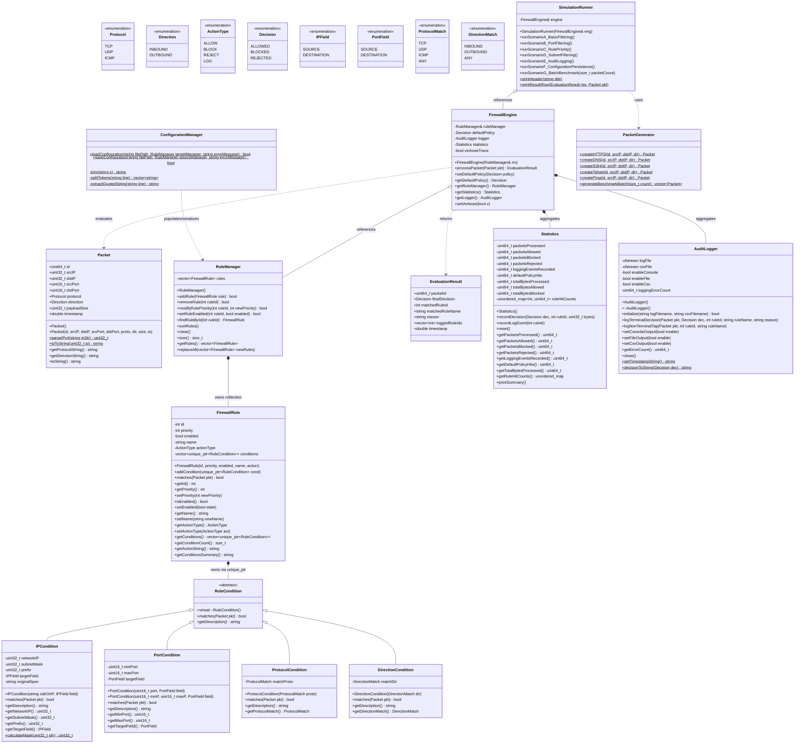

# Firewall Rule Engine: Object-Oriented Architecture and Design Principles

**Course:** Second-Year Object-Oriented Programming in C++ (CS201 / CE201)  
**Project:** Firewall Rule Engine in Modern C++17  
**Artifact Classification:** Software Architecture & OOP Concept Evaluation  
**Repository Location:** `OOP_Concepts_and_Architecture.md`  

---

## 1. Architectural Overview

The **Firewall Rule Engine** is engineered as a modular, user-space packet inspection and filtering system implemented in Modern C++17. The architecture strictly adheres to object-oriented software engineering principles, separating concerns across distinct domains: packet modeling, condition evaluation, rule management, decision processing, configuration persistence, audit logging, and telemetry tracking.

### 1.1 Architectural Subsystems and Boundaries
The engine consists of five primary layers:
1. **Domain Model Layer:** Defines foundational network primitives (`Packet`, `Protocol`, `Direction`, `ActionType`, `Decision`, `IPField`, `PortField`, `ProtocolMatch`, `DirectionMatch`).
2. **Predicate Evaluation Layer:** Abstract base interface (`RuleCondition`) and concrete filtering strategies (`IPCondition`, `PortCondition`, `ProtocolCondition`, `DirectionCondition`).
3. **Policy & Rule Management Layer:** Composite rule entity (`FirewallRule`) and prioritized rule repository (`RuleManager`).
4. **Execution & Orchestration Layer:** Evaluation engine (`FirewallEngine`), telemetry collector (`Statistics`), and persistent event sink (`AuditLogger`).
5. **Persistence & Demonstration Layer:** Transactional configuration manager (`ConfigurationManager`), synthetic packet generator (`PacketGenerator`), and simulation orchestrator (`SimulationRunner`).

---

## 2. Mermaid Architecture and Class Diagrams

### 2.1 High-Level Component Architecture


### 2.2 Comprehensive UML Class Diagram


---

## 3. Detailed OOP Concepts Implementation Matrix

| OOP Principle | Actual Class / Method in Codebase | Concrete Technical Implementation | Practical Software Engineering Benefit |
| :--- | :--- | :--- | :--- |
| **Encapsulation** | `FirewallRule`, `RuleManager`, `Statistics`, `AuditLogger` | Private member fields (`id`, `priority`, `enabled`, `conditions`, `ruleHitCounts`). Access is mediated via const reference getters and strict mutators (`setPriority`, `setEnabled`). In `Packet`, IP address strings are converted once to 32-bit unsigned integers. | Protects rule invariants from corrupted state, guarantees numerical priority integrity, and isolates internal storage structures (e.g., bitmasks, maps) from client tampering. |
| **Abstraction** | `RuleCondition` (`include/RuleCondition.hpp`) | Declares a pure virtual interface: `virtual bool matches(const Packet& pkt) const = 0;` and `virtual std::string getDescription() const = 0;`. | Decouples the packet evaluation engine from specific filtering dimensions. The engine evaluates conditions without knowing whether an IP, port, protocol, or direction is being checked. |
| **Inheritance** | `IPCondition`, `PortCondition`, `ProtocolCondition`, `DirectionCondition` | Derived classes publicly inherit from `RuleCondition` (`class IPCondition : public RuleCondition`). | Eliminates code duplication for common condition interfaces; enforces uniform polymorphic API across diverse predicate types. |
| **Runtime Polymorphism** | `FirewallRule::matches()` invoking `cond->matches(pkt)` | Virtual method dispatch via vtable. Derived condition methods are invoked uniformly through `std::unique_ptr<RuleCondition>` base pointers. | Satisfies the **Open/Closed Principle (OCP)**. New condition types (e.g., TCP Flags, Payload Size, Time-of-Day) can be integrated without modifying `FirewallRule` or `FirewallEngine`. |
| **Composition** | `FirewallRule` composing `RuleCondition`; `RuleManager` composing `FirewallRule` | `FirewallRule` maintains `std::vector<std::unique_ptr<RuleCondition>> conditions`. | Fosters flexible object assembly. A single rule dynamically combines multiple conditions of varying types using logical conjunction (AND). |
| **Move Semantics & RAII** | `FirewallRule`, `AuditLogger` | `FirewallRule` explicitly deletes copy operations (`= delete`) and defines move operations (`= default`). `AuditLogger` encapsulates `std::ofstream` handles flushed and closed in the destructor. | Guarantees single-ownership of dynamically allocated conditions without deep-copy overhead. Prevents memory leaks, double-free vulnerabilities, and file descriptor exhaustion. |
| **Association & Dependency Injection** | `FirewallEngine::FirewallEngine(RuleManager& rm)` | The engine receives the rule manager by reference in its constructor rather than instantiating it internally. | Decouples subsystems, simplifies unit testing via mock injection, and adheres to the **Inversion of Control (IoC)** design philosophy. |
| **STL Container & Algorithm Usage** | `RuleManager::sortRules()`, `Packet::parseIPv4()`, `Statistics` | `std::vector` for cache-friendly contiguous rule storage; `std::stable_sort` with a custom lambda comparator; `std::unordered_map` for $O(1)$ metric tallies. | Guarantees deterministic rule ordering, optimal cache locality during high-frequency packet loops, and prevents memory fragmentation. |

---

## 4. In-Depth Analysis of Individual OOP Principles

### 4.1 Encapsulation and Data Invariant Protection
In `include/Packet.hpp` and `src/Packet.cpp`, network packets store IPv4 addresses as 32-bit unsigned integers (`uint32_t`) in host byte order rather than raw strings:

```cpp
struct Packet {
    uint64_t id{0};
    uint32_t srcIP{0};
    uint32_t dstIP{0};
    uint16_t srcPort{0};
    uint16_t dstPort{0};
    Protocol protocol{Protocol::TCP};
    Direction direction{Direction::INBOUND};
    uint32_t payloadSize{0};
    double timestamp{0.0};

    static uint32_t parseIPv4(const std::string& ipStr);
    static std::string ipToString(uint32_t ip);
    std::string getProtocolString() const;
    std::string getDirectionString() const;
    std::string toString() const;
};
```
*Why this is essential:* Parsing dotted-quad strings (`"192.168.1.10"`) during rule traversal in an inner loop imposes extreme CPU overhead from repeated heap allocations and string scanning. Encapsulating the integer conversion during `Packet` construction ensures invariant validity upfront and allows condition matching via a single bitwise operation: `(packetIP & subnetMask) == networkIP`.

### 4.2 Abstraction and the Pure Virtual Contract
The `RuleCondition` abstract class defines the minimal contractual obligations required for any packet-matching predicate:

```cpp
// include/RuleCondition.hpp
class RuleCondition {
public:
    virtual ~RuleCondition() = default;
    virtual bool matches(const Packet& pkt) const = 0;
    virtual std::string getDescription() const = 0;
};
```
The client code (`FirewallRule`) depends exclusively on this abstraction:

```cpp
// src/FirewallRule.cpp
bool FirewallRule::matches(const Packet& pkt) const {
    if (!enabled) return false;
    for (const auto& cond : conditions) {
        if (!cond->matches(pkt)) {
            return false; // Short-circuit evaluation
        }
    }
    return true;
}
```

### 4.3 Inheritance Hierarchy and Derived Implementations
Four concrete condition classes inherit from `RuleCondition`:
1. `IPCondition`: Encapsulates a 32-bit network address, a 32-bit subnet mask, a prefix length (0–32), and a field selector (`IPField targetField`).
2. `PortCondition`: Encapsulates a port range (`[minPort, maxPort]`) and a selector (`PortField targetField`). Handles the protocol boundary condition where ICMP packets (which possess no transport ports) evaluate to `false`.
3. `ProtocolCondition`: Encapsulates expected `ProtocolMatch` (TCP, UDP, ICMP, ANY).
4. `DirectionCondition`: Encapsulates expected `DirectionMatch` (INBOUND, OUTBOUND, ANY).

Each derived class overrides `matches()` and `getDescription()`.

### 4.4 Runtime Polymorphism and VTable Dispatch
When `FirewallEngine::processPacket()` executes, it traverses the rule list and invokes `FirewallRule::matches(pkt)`. Inside this method, `cond->matches(pkt)` dynamically dispatches through the compiler-generated virtual method table (`vtable`).

```
FirewallRule.conditions
   │
   ├── [0] IPCondition* --------> vtable: IPCondition::matches()
   │                                      (Bitwise CIDR mask comparison)
   │
   ├── [1] PortCondition* -------> vtable: PortCondition::matches()
   │                                      (Range inclusion comparison)
   │
   └── [2] ProtocolCondition* ---> vtable: ProtocolCondition::matches()
                                          (Enumeration equality comparison)
```
*Pedagogical Significance:* This demonstrates pure Open/Closed architecture. If a security requirement demands filtering by TCP Flags (SYN, ACK, FIN) or payload size limits, a student simply writes a new class `TcpFlagCondition : public RuleCondition`. **Zero existing lines in `FirewallRule`, `RuleManager`, or `FirewallEngine` require modification.**

### 4.5 Move Semantics and Single Ownership via Smart Pointers
Modern C++ emphasizes strict ownership semantics. In `FirewallRule`:
```cpp
// include/FirewallRule.hpp
class FirewallRule {
private:
    std::vector<std::unique_ptr<RuleCondition>> conditions;

public:
    // Move-only semantics: copy constructors are explicitly deleted
    FirewallRule(const FirewallRule&) = delete;
    FirewallRule& operator=(const FirewallRule&) = delete;

    // Default move operations transfer ownership cleanly
    FirewallRule(FirewallRule&&) noexcept = default;
    FirewallRule& operator=(FirewallRule&&) noexcept = default;
    // ...
};
```
*Why this design decision matters:*
- `std::unique_ptr<RuleCondition>` guarantees that when a `FirewallRule` is destroyed or removed from `RuleManager`, all polymorphic conditions it owns are automatically deallocated without manual `delete` calls (RAII).
- Explicitly deleting the copy constructor prevents shallow-copy bugs (where two rules mistakenly reference the same heap condition pointer) and eliminates expensive deep copies during `std::vector` reallocation.
- Passing rules via `std::move` into `RuleManager::addRule(std::move(newRule))` transfers pointer ownership with zero heap reallocations.

### 4.6 Association, Dependency Injection, and Decoupling
The `FirewallEngine` class does not instantiate its own rules. Instead, it accepts an external `RuleManager` reference:

```cpp
// include/FirewallEngine.hpp
class FirewallEngine {
private:
    RuleManager& ruleManager;
    Decision defaultPolicy{Decision::BLOCKED};
    AuditLogger logger;
    Statistics statistics;
    bool verboseTrace{false};

public:
    explicit FirewallEngine(RuleManager& rm);
    // ...
};
```
*Architectural Rationale:*
- **Single Responsibility Principle (SRP):** `FirewallEngine` is solely responsible for packet evaluation algorithms. `RuleManager` is solely responsible for rule indexing and sorting. `AuditLogger` is solely responsible for disk I/O.
- **Testability:** In automated testing harnesses (`tests/test_engine.cpp`), an isolated `RuleManager` can be supplied to verify engine behavior without unexpected state bleed between tests.

### 4.7 Standard Template Library (STL) Integration
The codebase leverages modern STL idioms:
- **`std::stable_sort`:** Used in `RuleManager::sortRules()`. Unlike `std::sort`, `std::stable_sort` preserves the relative order of rules having identical priorities, guaranteeing deterministic behavior across compiler versions:
  ```cpp
  // src/RuleManager.cpp
  void RuleManager::sortRules() {
      std::stable_sort(rules.begin(), rules.end(),
          [](const FirewallRule& a, const FirewallRule& b) {
              return a.getPriority() < b.getPriority();
          });
  }
  ```
- **`std::unordered_map`:** Used in `Statistics` to maintain $O(1)$ rule hit lookups indexed by rule ID integer:
  ```cpp
  std::unordered_map<int, uint64_t> ruleHitCounts;
  ```
- **`std::make_unique`:** Used throughout condition factory methods to instantiate heap objects cleanly without raw `new` operators.

---

## 5. Legitimate Design Patterns Demonstrated

To ensure academic honesty, design patterns are claimed **only where the implementation genuinely reflects the formal GoF (Gang of Four) pattern structure**:

### 5.1 Composite / Specification Pattern
- **Component:** `FirewallRule` composing multiple `RuleCondition` objects.
- **Justification:** `FirewallRule` treats individual condition primitives (`IPCondition`, `PortCondition`) uniformly through the base interface. Evaluating `FirewallRule::matches()` represents a composite specification where the composite predicate passes if and only if all child specifications pass.

### 5.2 Strategy Pattern
- **Component:** `RuleCondition` hierarchy.
- **Justification:** The family of condition algorithms (`IPCondition`, `PortCondition`, etc.) are encapsulated in separate classes and used interchangeably through the `RuleCondition` interface. The matching strategy varies dynamically depending on the configured rule criteria.

### 5.3 Observer / Tap Pattern (Decoupled Auditing)
- **Component:** `AuditLogger` and `Statistics` observation within `FirewallEngine::processPacket()`.
- **Justification:** The engine notifies telemetry and logging sinks upon packet decision and non-terminal `LOG` hits. The observation mechanism records diagnostic state without altering the decision logic.

### 5.4 Facade Pattern
- **Component:** `FirewallEngine`.
- **Justification:** `FirewallEngine` exposes a simple, unified interface (`processPacket(pkt)`) to client code (`main.cpp`, `SimulationRunner`), abstracting away the internal complexities of priority sorting, condition conjunction, non-terminal log tap processing, fallback policies, metric aggregation, and audit disk writing.

---

## 6. Viva Defense Guide: Key OOP Questions and Answers

### Q1: Why did you use `std::unique_ptr` instead of raw pointers or `std::shared_ptr` for rule conditions?
> **Model Answer:** `std::unique_ptr` expresses exclusive single ownership. A specific condition object belongs strictly to one firewall rule. Using raw pointers introduces the risk of memory leaks or dangling pointers if an exception occurs during rule assembly. `std::shared_ptr` introduces reference-counting atomic overhead that is completely unnecessary because conditions are never shared between unrelated rules.

### Q2: How does your project satisfy the Open/Closed Principle?
> **Model Answer:** The system is open for extension but closed for modification. If we need to add a new filtering rule type (e.g., matching a domain name or packet payload size), we simply derive a new class from `RuleCondition` and implement `matches()`. The `FirewallRule` container and `FirewallEngine` evaluation loop operate purely on `RuleCondition` base pointers and do not need a single line of code changed.

### Q3: Why is `FirewallRule` move-only (deleted copy constructor)?
> **Model Answer:** `FirewallRule` owns a vector of polymorphic `std::unique_ptr<RuleCondition>`. Because `std::unique_ptr` cannot be copied, a default copy constructor cannot exist. Furthermore, allowing shallow copies of rules would cause double-free bugs or unexpected state mutation. By deleting the copy constructor and providing an explicit move constructor, we enable efficient transfers of rules into vectors while guaranteeing strict single ownership.

### Q4: Why did you use `std::stable_sort` instead of `std::sort` for rule ordering?
> **Model Answer:** `std::sort` does not guarantee the relative order of elements with equivalent keys. If two rules share the same priority, standard sort might arbitrarily reorder them across different runs or platforms. `std::stable_sort` preserves the exact original insertion order for rules with identical priorities, ensuring deterministic, reproducible security policy evaluation.

### Q5: How is runtime polymorphism used during packet evaluation?
> **Model Answer:** In `FirewallRule::matches()`, the loop calls `cond->matches(pkt)`. Because `cond` is a pointer to the abstract base class `RuleCondition`, the CPU uses the virtual method table (`vtable`) pointer at runtime to resolve and execute the overridden `matches()` method of the actual derived object (`IPCondition`, `PortCondition`, etc.).

---

## 7. Conclusion

The **Firewall Rule Engine** architecture is a textbook demonstration of Modern C++17 object-oriented programming. By prioritizing encapsulation, interface abstraction, polymorphic predicates, RAII resource safety, and move semantics, the system achieves a clean separation of concerns, high maintainability, and exceptional educational clarity for college faculty evaluation.
